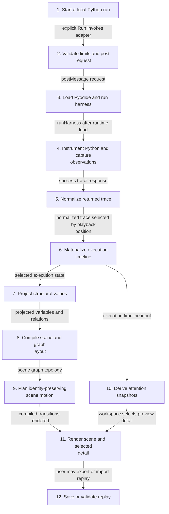
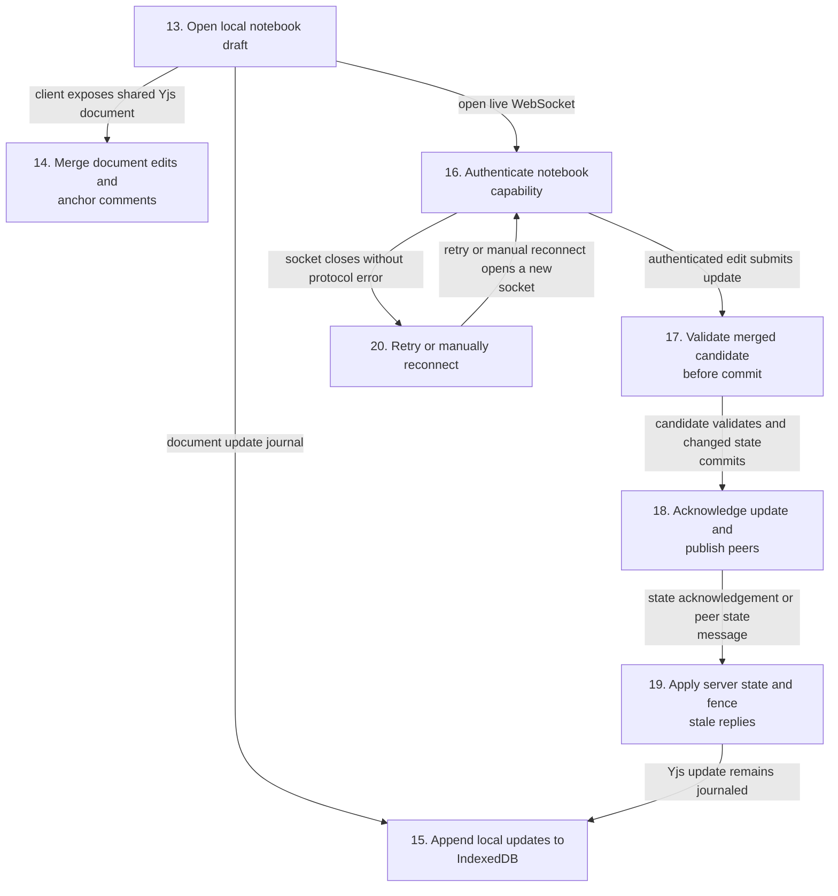
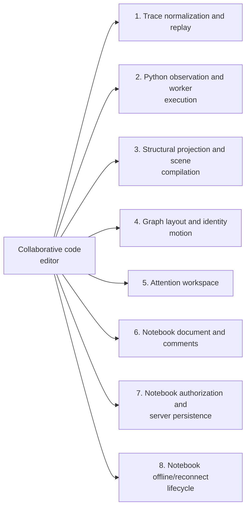
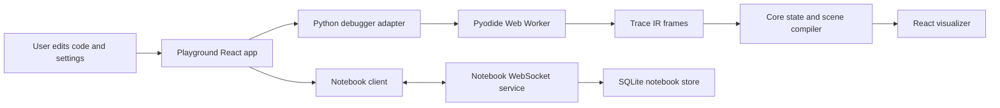
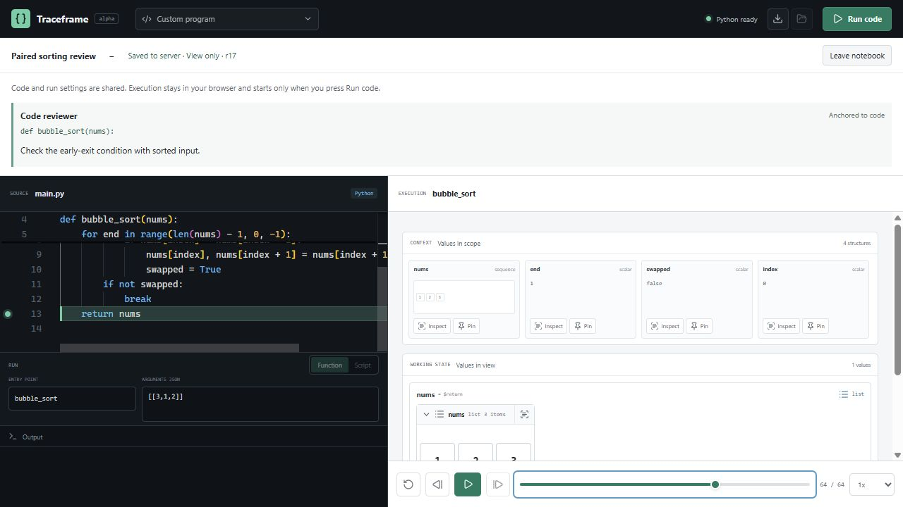

# Collaborative code editor

## Architecture and execution guide

<!-- execution-flow:start -->
### Execution flow

Start with the primary path, then expand a detailed workflow. Select a numbered node to see its operation, implementation techniques, and source. Solid arrows show the named control, data, or lifecycle handoff; dotted arrows show error paths. Separate entry points are named in each workflow.

<a id="review-walkthrough"></a>

#### Walk through one concrete example

Run the Python snippet `values = [3, 1, 2]; values.sort(); print(values)` in the playground and inspect its trace.

**Trace.** [Start a local Python run](#flow-step-playground-run) → [Validate limits and post request](#flow-step-adapter-request) → [Instrument Python and capture observations](#flow-step-instrument-capture) → [Normalize returned trace](#flow-step-adapter-normalize) → [Materialize execution timeline](#flow-step-timeline) → [Compile scene and graph layout](#flow-step-scene-layout) → [Plan identity-preserving scene motion](#flow-step-motion-plan) → [Render scene and selected detail](#flow-step-render-detail).

**Result and boundary.** The playground displays a normalized execution trace as a scene with playback and selectable detail. Execution is bounded in a browser worker; this path does not imply replay export or notebook synchronization.

<details>
<summary>Implementation decisions to explain</summary>

**Why instrument Python at the AST level instead of sampling only final values?** AST instrumentation captures semantic execution observations, while stable member IDs let the visualizer recognize values across snapshots. The tradeoff is added instrumentation and bounded trace collection; it is not a general Python debugger for arbitrary native extensions.

[AST instrumentation](#technique-ast-instrumentation) · [Stable runtime identity](#technique-stable-runtime-identity).

</details>

#### Primary execution flow

The Run action captures Python in a worker and renders trace states. Notebook synchronization has its own workflow and does not dispatch execution.



**Detailed workflows.** [Run Python and render a trace](#flow-workflow-python-trace-render) · [Synchronize and retain notebook edits](#flow-workflow-notebook-sync).

<a id="flow-workflow-python-trace-render"></a>

<details>
<summary>Run Python and render a trace</summary>

The explicit Run action invokes a browser worker. This path ends in the React visualizer; replay import and export remain user-triggered operations.


</details>

<a id="flow-workflow-notebook-sync"></a>

<details>
<summary>Synchronize and retain notebook edits</summary>

Notebook Yjs sync is separate from Python execution. The browser keeps an IndexedDB draft while a capability-authenticated WebSocket exchanges document state with the service.



</details>

#### Steps, techniques, and source

These source traces cover the active scope below. They explain implementation behavior; benchmark results and their limits remain in the measurement sections.

<a id="flow-step-playground-run"></a>

##### 1. Start a local Python run

**Component.** apps/playground/src/App.tsx execute. The Run action captures the current source and run specification, advances an execution version, and asks the debugger adapter to execute in the browser. A source edit invalidates the prior result so an older completion cannot replace it.

UI event dispatch and stale-result fencing are ordinary application control flow.

**Source.** [`apps/playground/src/App.tsx:297`](https://github.com/STEVVVU/collaborative-code-editor/blob/main/apps/playground/src/App.tsx#L297). [Back to execution flow](#execution-flow).

<a id="flow-step-adapter-request"></a>

##### 2. Validate limits and post request

**Component.** PyodideDebuggerAdapter.executeRun. The adapter validates positive frame and memory limits, assigns a request ID, tracks a timeout, and posts source, run mode, frame budget, and memory limit to a dedicated module worker. Startup, execution, and visualization have separate timeout windows.

**Techniques at this step.** [Isolated worker execution and cancellation](#technique-isolated-worker-execution-and-cancellation) · [Execution resource bounds](#technique-execution-resource-bounds).

**Source.** [`packages/python/src/pyodideDebuggerAdapter.ts:195`](https://github.com/STEVVVU/collaborative-code-editor/blob/main/packages/python/src/pyodideDebuggerAdapter.ts#L195). [Back to execution flow](#execution-flow).

<a id="flow-step-worker-runtime"></a>

##### 3. Load Pyodide and run harness

**Component.** python.worker.ts message handler. The worker lazily loads one Pyodide runtime, installs request values in Python globals, emits a tracing phase, runs the Python harness, then removes request globals. It returns either the trace or a failure message to the adapter.

**Techniques at this step.** [Isolated worker execution and cancellation](#technique-isolated-worker-execution-and-cancellation).

**Source.** [`packages/python/src/python.worker.ts:1750`](https://github.com/STEVVVU/collaborative-code-editor/blob/main/packages/python/src/python.worker.ts#L1750) · [`packages/python/src/python.worker.ts:1783`](https://github.com/STEVVVU/collaborative-code-editor/blob/main/packages/python/src/python.worker.ts#L1783). [Back to execution flow](#execution-flow).

<a id="flow-step-instrument-capture"></a>

##### 4. Instrument Python and capture observations

**Component.** python.worker.py Instrumenter and harness. The harness parses and instruments the submitted Python AST, executes under source tracing, and records frame and semantic observations. Stable member IDs preserve identity across snapshots; frame and memory budgets constrain collection, and exceptions return as failed worker responses.

**Techniques at this step.** [AST instrumentation](#technique-ast-instrumentation) · [Stable runtime identity](#technique-stable-runtime-identity) · [Execution resource bounds](#technique-execution-resource-bounds).

**Source.** [`packages/python/src/python.worker.ts:834`](https://github.com/STEVVVU/collaborative-code-editor/blob/main/packages/python/src/python.worker.ts#L834) · [`packages/python/src/python.worker.ts:114`](https://github.com/STEVVVU/collaborative-code-editor/blob/main/packages/python/src/python.worker.ts#L114) · [`packages/python/src/python.worker.ts:1457`](https://github.com/STEVVVU/collaborative-code-editor/blob/main/packages/python/src/python.worker.ts#L1457). [Back to execution flow](#execution-flow).

<a id="flow-step-adapter-normalize"></a>

##### 5. Normalize returned trace

**Component.** PyodideDebuggerAdapter.handleResponse. A failed response rejects the pending run. A successful response inherits persistent bindings, coalesces repeated frames, indexes semantic steps, expands them for playback, and upgrades the trace to the current IR version.

**Techniques at this step.** [Frame coalescing](#technique-frame-coalescing) · [Versioned replay validation and upgrade](#technique-versioned-replay-validation-and-upgrade).

**Source.** [`packages/python/src/pyodideDebuggerAdapter.ts:363`](https://github.com/STEVVVU/collaborative-code-editor/blob/main/packages/python/src/pyodideDebuggerAdapter.ts#L363) · [`packages/core/src/diff.ts:139`](https://github.com/STEVVVU/collaborative-code-editor/blob/main/packages/core/src/diff.ts#L139) · [`packages/core/src/traceUpgrade.ts:184`](https://github.com/STEVVVU/collaborative-code-editor/blob/main/packages/core/src/traceUpgrade.ts#L184). [Back to execution flow](#execution-flow).

<a id="flow-step-timeline"></a>

##### 6. Materialize execution timeline

**Component.** executionModel.ts materializeExecutionTimeline. Core walks debugger steps and frames, carries suspended activations and producer facts forward, and materializes execution state at each playback position. The timeline feeds the selected frame and attention derivation.

**Techniques at this step.** [Execution timeline materialization](#technique-execution-timeline-materialization).

**Source.** [`packages/core/src/executionModel.ts:416`](https://github.com/STEVVVU/collaborative-code-editor/blob/main/packages/core/src/executionModel.ts#L416). [Back to execution flow](#execution-flow).

<a id="flow-step-projection"></a>

##### 7. Project structural values

**Component.** scene.ts projectStructural. The projection registry resolves values and explicit graph contracts, then projects values into structural scene data. Relation graphs derive links from stable object identities; unsupported or invalid graph contracts do not become inferred adjacency semantics.

**Techniques at this step.** [Contracted structural projection](#technique-contracted-structural-projection) · [Identity-derived relation graphs](#technique-identity-derived-relation-graphs).

**Source.** [`packages/core/src/scene.ts:747`](https://github.com/STEVVVU/collaborative-code-editor/blob/main/packages/core/src/scene.ts#L747) · [`packages/core/src/scene.ts:2244`](https://github.com/STEVVVU/collaborative-code-editor/blob/main/packages/core/src/scene.ts#L2244). [Back to execution flow](#execution-flow).

<a id="flow-step-scene-layout"></a>

##### 8. Compile scene and graph layout

**Component.** scene.ts compileScene and topologyLayout.ts layoutRelationGraph. The selected execution state and projections compile into scene variables and relations. Contracted relation graphs use topology-aware layout to place vertices and edges for rendering.

**Techniques at this step.** [Topology-aware layout](#technique-topology-aware-layout).

**Source.** [`packages/core/src/scene.ts:2475`](https://github.com/STEVVVU/collaborative-code-editor/blob/main/packages/core/src/scene.ts#L2475) · [`packages/core/src/topologyLayout.ts:185`](https://github.com/STEVVVU/collaborative-code-editor/blob/main/packages/core/src/topologyLayout.ts#L185). [Back to execution flow](#execution-flow).

<a id="flow-step-motion-plan"></a>

##### 9. Plan identity-preserving scene motion

**Component.** motion.ts compileMotionPlan. The renderer compares entities by identity and produces transitions for retained, entered, and removed entities. Graph topology transitions add collision-aware routing when relation graph structure changes.

**Techniques at this step.** [Identity-based motion planning](#technique-identity-based-motion-planning) · [Collision-aware topology transitions](#technique-collision-aware-topology-transitions).

**Source.** [`packages/core/src/motion.ts:17`](https://github.com/STEVVVU/collaborative-code-editor/blob/main/packages/core/src/motion.ts#L17) · [`packages/core/src/topologyMotion.ts:145`](https://github.com/STEVVVU/collaborative-code-editor/blob/main/packages/core/src/topologyMotion.ts#L145). [Back to execution flow](#execution-flow).

<a id="flow-step-attention-timeline"></a>

##### 10. Derive attention snapshots

**Component.** attention.ts compileAttentionTimeline. Core derives attention views from execution states, including changes, semantic events, and paths into nested projections. The React workspace combines automatic working views with user pins.

**Techniques at this step.** [Derived attention timeline](#technique-derived-attention-timeline).

**Source.** [`packages/core/src/attention.ts:286`](https://github.com/STEVVVU/collaborative-code-editor/blob/main/packages/core/src/attention.ts#L286) · [`packages/react/src/AttentionWorkspace.tsx:54`](https://github.com/STEVVVU/collaborative-code-editor/blob/main/packages/react/src/AttentionWorkspace.tsx#L54). [Back to execution flow](#execution-flow).

<a id="flow-step-render-detail"></a>

##### 11. Render scene and selected detail

**Component.** VisualizerContent. The visualizer renders compiled scene state and motion, with playback controls and selectable nested projections. Attention previews choose token, thumbnail, or full detail based on the selected level.

**Techniques at this step.** [Semantic levels of detail](#technique-semantic-level-of-detail).

**Source.** [`packages/react/src/Visualizer.tsx:319`](https://github.com/STEVVVU/collaborative-code-editor/blob/main/packages/react/src/Visualizer.tsx#L319) · [`packages/react/src/ProjectionPreview.tsx:41`](https://github.com/STEVVVU/collaborative-code-editor/blob/main/packages/react/src/ProjectionPreview.tsx#L41). [Back to execution flow](#execution-flow).

<a id="flow-step-replay-save-open"></a>

##### 12. Save or validate replay

**Component.** replay.ts serializeReplay and parseReplay. The playground can serialize a completed trace to a versioned replay file. On import, the parser checks format, version, trace values, and execution metadata before upgrading the trace; invalid input throws rather than entering playback.

**Techniques at this step.** [Versioned replay validation and upgrade](#technique-versioned-replay-validation-and-upgrade).

**Source.** [`packages/core/src/replay.ts:626`](https://github.com/STEVVVU/collaborative-code-editor/blob/main/packages/core/src/replay.ts#L626) · [`packages/core/src/replay.ts:622`](https://github.com/STEVVVU/collaborative-code-editor/blob/main/packages/core/src/replay.ts#L622). [Back to execution flow](#execution-flow).

<a id="flow-step-notebook-start"></a>

##### 13. Open local notebook draft

**Component.** NotebookClient.start. The client hashes the capability token to scope IndexedDB storage, restores cached role and revision metadata, attaches a Yjs update listener, then opens a live socket. Storage failure publishes an error and prevents connection startup.

**Techniques at this step.** [IndexedDB append journal](#technique-indexeddb-append-journal) · [Acknowledgement tracking and stale-response fencing](#technique-acknowledgement-tracking-and-stale-response-fencing).

**Source.** [`apps/playground/src/notebook/client.ts:50`](https://github.com/STEVVVU/collaborative-code-editor/blob/main/apps/playground/src/notebook/client.ts#L50) · [`apps/playground/src/notebook/persistence.ts:3`](https://github.com/STEVVVU/collaborative-code-editor/blob/main/apps/playground/src/notebook/persistence.ts#L3). [Back to execution flow](#execution-flow).

<a id="flow-step-document-edit"></a>

##### 14. Merge document edits and anchor comments

**Component.** Yjs notebook document. Yjs merges document updates. An annotation stores relative start and end positions so it can resolve against later source edits; the service validates these positions when it accepts a candidate document.

**Techniques at this step.** [Yjs CRDT merge with relative comment anchors](#technique-yjs-crdt-merge-with-relative-comment-anchors).

**Source.** [`apps/playground/src/notebook/document.ts:54`](https://github.com/STEVVVU/collaborative-code-editor/blob/main/apps/playground/src/notebook/document.ts#L54) · [`apps/playground/src/notebook/document.ts:86`](https://github.com/STEVVVU/collaborative-code-editor/blob/main/apps/playground/src/notebook/document.ts#L86). [Back to execution flow](#execution-flow).

<a id="flow-step-persist-local"></a>

##### 15. Append local updates to IndexedDB

**Component.** NotebookPersistence.storeUpdate. Local Yjs updates append to the IndexedDB update journal; opening storage replays the journal into the document before the client connects. Storage errors are surfaced to the client while the tab remains open.

**Techniques at this step.** [IndexedDB append journal](#technique-indexeddb-append-journal).

**Source.** [`apps/playground/src/notebook/persistence.ts:97`](https://github.com/STEVVVU/collaborative-code-editor/blob/main/apps/playground/src/notebook/persistence.ts#L97) · [`apps/playground/src/notebook/persistence.ts:21`](https://github.com/STEVVVU/collaborative-code-editor/blob/main/apps/playground/src/notebook/persistence.ts#L21). [Back to execution flow](#execution-flow).

<a id="flow-step-client-auth"></a>

##### 16. Authenticate notebook capability

**Component.** server.mjs roleFor and WebSocket connection. The server checks the token length, hashes it, and compares it with stored edit and view hashes using timing-safe equality. A socket that does not authenticate within five seconds is sent an error and closed.

**Techniques at this step.** [Capability hashing and role authorization](#technique-capability-hashing-and-role-authorization).

**Source.** [`apps/notebook-server/src/server.mjs:124`](https://github.com/STEVVVU/collaborative-code-editor/blob/main/apps/notebook-server/src/server.mjs#L124) · [`apps/notebook-server/src/server.mjs:306`](https://github.com/STEVVVU/collaborative-code-editor/blob/main/apps/notebook-server/src/server.mjs#L306). [Back to execution flow](#execution-flow).

<a id="flow-step-candidate-validate"></a>

##### 17. Validate merged candidate before commit

**Component.** server.mjs WebSocket update handler. For an edit-role update, the server merges incoming Yjs state with stored state in a temporary document and validates schema, field limits, contracts, annotations, relative positions, and encoded document size. It persists a changed candidate and advances revision only after validation succeeds.

**Techniques at this step.** [Validate candidates before transaction and broadcast](#technique-validate-candidates-before-transaction-and-broadcast).

**Source.** [`apps/notebook-server/src/server.mjs:75`](https://github.com/STEVVVU/collaborative-code-editor/blob/main/apps/notebook-server/src/server.mjs#L75) · [`apps/notebook-server/src/server.mjs:322`](https://github.com/STEVVVU/collaborative-code-editor/blob/main/apps/notebook-server/src/server.mjs#L322). [Back to execution flow](#execution-flow).

<a id="flow-step-ack-broadcast"></a>

##### 18. Acknowledge update and publish peers

**Component.** server.mjs WebSocket update handler. The server acknowledges the sender with its update ID and committed revision, then sends changed state to other room peers. A view-role client cannot submit updates; invalid candidates return an error without a commit or broadcast.

**Techniques at this step.** [Validate candidates before transaction and broadcast](#technique-validate-candidates-before-transaction-and-broadcast).

**Source.** [`apps/notebook-server/src/server.mjs:322`](https://github.com/STEVVVU/collaborative-code-editor/blob/main/apps/notebook-server/src/server.mjs#L322). [Back to execution flow](#execution-flow).

<a id="flow-step-client-reconcile"></a>

##### 19. Apply server state and fence stale replies

**Component.** NotebookClient socket message handler. The client ignores messages from replaced sockets, applies valid server Yjs state with origin server, records role and revision, and clears a matching acknowledgement ID. Invalid responses close the socket while retaining the local draft.

**Techniques at this step.** [Acknowledgement tracking and stale-response fencing](#technique-acknowledgement-tracking-and-stale-response-fencing) · [Yjs CRDT merge with relative comment anchors](#technique-yjs-crdt-merge-with-relative-comment-anchors).

**Source.** [`apps/playground/src/notebook/client.ts:163`](https://github.com/STEVVVU/collaborative-code-editor/blob/main/apps/playground/src/notebook/client.ts#L163). [Back to execution flow](#execution-flow).

<a id="flow-step-reconnect"></a>

##### 20. Retry or manually reconnect

**Component.** NotebookClient reconnect and onclose. A non-error socket close publishes offline state and schedules a retry after two seconds. Manual reconnect closes the old socket and either reinitializes failed storage or opens a new socket; disposal cancels the retry and closes resources.

**Techniques at this step.** [Acknowledgement tracking and stale-response fencing](#technique-acknowledgement-tracking-and-stale-response-fencing) · [IndexedDB append journal](#technique-indexeddb-append-journal).

**Source.** [`apps/playground/src/notebook/client.ts:241`](https://github.com/STEVVVU/collaborative-code-editor/blob/main/apps/playground/src/notebook/client.ts#L241) · [`apps/playground/src/notebook/client.ts:261`](https://github.com/STEVVVU/collaborative-code-editor/blob/main/apps/playground/src/notebook/client.ts#L261). [Back to execution flow](#execution-flow).

<details>
<summary>Scope and subsystem coverage</summary>

Active Python worker execution and observation, trace normalization/replay, projection and scene rendering, identity motion, attention, plus notebook client, capability authorization, server persistence, IndexedDB draft, and reconnect lifecycle.

- **Trace normalization and replay.** Worker results are coalesced and upgraded before materialized playback state; replay import validates versioned data. [Step 5](#flow-step-adapter-normalize), [Step 6](#flow-step-timeline), [Step 12](#flow-step-replay-save-open).
- **Python observation and worker execution.** Adapter request bounds, worker lifecycle, AST observation, stable identity, and resource limits are represented. [Step 2](#flow-step-adapter-request), [Step 3](#flow-step-worker-runtime), [Step 4](#flow-step-instrument-capture), [Step 5](#flow-step-adapter-normalize).
- **Structural projection and scene compilation.** Contract resolution and identity-derived relations feed scene compilation. [Step 7](#flow-step-projection), [Step 8](#flow-step-scene-layout).
- **Graph layout and identity motion.** Relation graph layout feeds identity motion and topology-aware transitions rendered by React. [Step 8](#flow-step-scene-layout), [Step 9](#flow-step-motion-plan), [Step 11](#flow-step-render-detail).
- **Attention workspace.** Core derives attention snapshots; React applies selected semantic detail levels to nested previews. [Step 10](#flow-step-attention-timeline), [Step 11](#flow-step-render-detail).
- **Notebook document and comments.** Yjs merges updates and relative positions keep annotation ranges tied to edited source. [Step 14](#flow-step-document-edit), [Step 19](#flow-step-client-reconcile).
- **Notebook authorization and server persistence.** Role checks precede update validation; the server persists validated changed state before acknowledgement and peer delivery. [Step 16](#flow-step-client-auth), [Step 17](#flow-step-candidate-validate), [Step 18](#flow-step-ack-broadcast).
- **Notebook offline/reconnect lifecycle.** Capability-scoped IndexedDB replay precedes connection; updates are journaled and reconnect retries retain the local Yjs document. [Step 13](#flow-step-notebook-start), [Step 15](#flow-step-persist-local), [Step 19](#flow-step-client-reconcile), [Step 20](#flow-step-reconnect).

</details>

<!-- execution-flow:end -->

<details>
<summary>Subsystem technique index</summary>

### Subsystem map

Select a subsystem in the diagram to open its techniques, tradeoffs, and code references. The numbered links provide the same navigation. This map groups components; the execution diagrams show their runtime flow.



1. [Trace normalization and replay](#subsystem-trace-normalization-and-replay)
2. [Python observation and worker execution](#subsystem-python-observation-and-worker-execution)
3. [Structural projection and scene compilation](#subsystem-structural-projection-and-scene-compilation)
4. [Graph layout and identity motion](#subsystem-graph-layout-and-identity-motion)
5. [Attention workspace](#subsystem-attention-workspace)
6. [Notebook document and comments](#subsystem-notebook-document-and-comments)
7. [Notebook authorization and server persistence](#subsystem-notebook-authorization-and-server-persistence)
8. [Notebook offline/reconnect lifecycle](#subsystem-notebook-offlinereconnect-lifecycle)

Traceframe implements a language-neutral trace model, a Python adapter, projection and replay packages, and a React renderer. The playground and notebook service are applications built on those packages. Pyodide, React, Monaco, Yjs, and SQLite are dependencies rather than Traceframe-owned engines. A [Trace IR](#trace-ir) captures execution facts; a [projection contract](#projection-contract) selects an intentional view.

The worker returns observations, core turns them into scenes, and React presents the trace. Notebook synchronization is separate and never starts execution.

</details>

<details>
<summary>Expand flow diagram 1</summary>



</details>

The trace path separates collection from visualization. Core builds [materialized state](#materialized-state) for each trace position and can save a [replay](#replay). Notebook updates travel through a [Yjs document](#yjs-document) between clients and the service; Python execution requires an explicit Run action. Shared access uses a [capability link](#capability-link).

```mermaid
flowchart TD
  subgraph Browser["Browser execution and presentation"]
    Edit["Edit source and run settings"] --> Validate["Validate arguments and contracts"]
    Validate --> Execute["Execute in Pyodide worker"]
    Execute --> Limit{"Error or limit reached?"}
    Limit -->|"No"| Capture["Capture frames and serialize values"]
    Limit -->|"Yes"| Failure["Return visible failure"]
    Capture --> Upgrade["Upgrade and materialize Trace IR"]
    Upgrade --> Project["Apply projections"]
    Project --> Scene["Compile scene and layout"]
    Scene --> Render["Render and scrub frames"]
    Render --> Save["Optionally save replay"]
  end
  subgraph Collaboration["Notebook collaboration"]
    Client["Yjs document client"] <--> Socket["Role-gated WebSocket"]
    Socket <--> Store["SQLite document and capability hashes"]
    Client --> Draft["IndexedDB offline draft"]
  end
```

<details>
<summary>Expand flow diagram 2</summary>



</details>

| Subsystem | Responsibility and owned state | Source |
|---|---|---|
| Trace model and compiler | Trace IR, replay upgrades, execution state, projection registry, scene compilation | [`types.ts`](packages/core/src/types.ts), [`architecture`](docs/architecture.md) |
| Python adapter | Worker lifecycle, request limits, status, and raw-step mapping | [`adapter`](packages/python/src/pyodideDebuggerAdapter.ts), [`worker`](packages/python/src/python.worker.ts) |
| React renderer | Scene rendering, playback, attention workspace, and motion | [`Visualizer.tsx`](packages/react/src/Visualizer.tsx), [`AttentionWorkspace.tsx`](packages/react/src/AttentionWorkspace.tsx) |
| Playground | Source, run settings, trace and replay interaction | [`App.tsx`](apps/playground/src/App.tsx) |
| Notebook client and persistence | Yjs document, IndexedDB draft, connection and merge state | [`useNotebook.ts`](apps/playground/src/notebook/useNotebook.ts), [`persistence.ts`](apps/playground/src/notebook/persistence.ts) |
| Notebook service | Role capabilities, document validation, WebSocket updates and SQLite persistence | [`server.mjs`](apps/notebook-server/src/server.mjs) |

### Execution journey

1. Choose an example or enter Python; select script or function mode and JSON arguments.
2. The adapter sends source to a dedicated worker, which runs Pyodide, instruments execution, and serializes observed values.
3. Core upgrades older traces as needed, materializes state, and applies structural projections. An explicit contract can select an adjacency-list graph.
4. The visualizer renders the scene; playback seeks recorded frames. Replays can be saved and reopened.
5. Time, memory, frame, parse, runtime, or worker failures become visible errors. A source edit invalidates stale results.

### Design decisions and tradeoffs

Rationales are inferred from current implementation.

| Choice | Practical reason | Alternative and cost to reconsider |
|---|---|---|
| Trace IR separates language observations from scenes | Other adapters can feed the same projection and renderer layers | Render Python events directly, coupling language and view code |
| Structural views are defaults; graph views need contracts | A list does not establish graph semantics | Infer graphs heuristically, which can misread ordinary nested lists |
| Python runs in a browser worker | A run does not block UI rendering and can be monitored | Main-thread execution blocks UI; server execution changes code locality |
| Notebook execution is explicit and client-local | Shared edits cannot trigger another participant's code | Auto-run edits, which executes unreviewed shared changes |
| Access uses role links and stored hashes | Grants editor or viewer access without an account system | Add identity and individual revocation, which requires a new lifecycle |

### Glossary

<a id="trace-ir"></a>

<details><summary>What is Trace IR?</summary>

Trace IR is the versioned record of execution events and values. The adapter emits it and core materializes it; it is not the rendered scene.

</details>

<a id="projection-contract"></a>

<details><summary>What is a projection contract?</summary>

A projection contract declares how to view a selected runtime value. An adjacency list can be marked as a directed graph; a missing target selects nothing.

</details>

<a id="materialized-state"></a>

<details><summary>What is materialized state?</summary>

It is reconstructed program state at a trace position, derived from events so frames can be displayed and compared.

</details>

<a id="replay"></a>

<details><summary>What is a replay?</summary>

A replay is a saved versioned trace that can be reopened without rerunning source. Supported older formats pass through the core upgrade path.

</details>

<a id="yjs-document"></a>

<details><summary>What is a Yjs document?</summary>

A Yjs document is a mergeable shared data structure for notebook source, settings, and comments. It synchronizes edits but does not run Python.

</details>

<a id="capability-link"></a>

<details><summary>What is a capability link?</summary>

A capability link grants its role to whoever possesses it. The service stores hashes; there are no individual accounts or per-link revocation.

</details>

## Implementation techniques

This section covers the active execution, projection and notebook paths listed in the architecture table. Design rationales are inferred from current code.

<details>
<summary>Full technique index</summary>

| Active subsystem | Technique cards | Source files |
|---|---|---|
| Trace normalization and replay | [Frame coalescing](#technique-frame-coalescing), [Execution timeline materialization](#technique-execution-timeline-materialization), [Versioned replay validation and upgrade](#technique-versioned-replay-validation-and-upgrade) | `packages/core/src/diff.ts`, `packages/core/src/executionModel.ts`, `packages/core/src/replay.ts`, `packages/core/src/traceUpgrade.ts` |
| Python observation and worker execution | [AST instrumentation](#technique-ast-instrumentation), [Stable runtime identity](#technique-stable-runtime-identity), [Isolated worker execution and cancellation](#technique-isolated-worker-execution-and-cancellation), [Execution resource bounds](#technique-execution-resource-bounds) | `packages/python/src/python.worker.ts`, `packages/python/src/pyodideDebuggerAdapter.ts`, `packages/python/src/workerProtocol.ts` |
| Structural projection and scene compilation | [Contracted structural projection](#technique-contracted-structural-projection), [Identity-derived relation graphs](#technique-identity-derived-relation-graphs) | `packages/core/src/scene.ts` |
| Graph layout and identity motion | [Topology-aware layout](#technique-topology-aware-layout), [Identity-based motion planning](#technique-identity-based-motion-planning), [Collision-aware topology transitions](#technique-collision-aware-topology-transitions) | `packages/core/src/topologyLayout.ts`, `packages/core/src/topologyMotion.ts`, `packages/core/src/motion.ts`, `packages/react/src/SceneMotionController.ts` |
| Attention workspace | [Derived attention timeline](#technique-derived-attention-timeline), [Semantic levels of detail](#technique-semantic-level-of-detail) | `packages/core/src/attention.ts`, `packages/react/src/AttentionWorkspace.tsx` |
| Notebook document and comments | [Yjs CRDT merge with relative comment anchors](#technique-yjs-crdt-merge-with-relative-comment-anchors) | `apps/playground/src/notebook/client.ts`, `apps/playground/src/notebook/document.ts` |
| Notebook authorization and server persistence | [Capability hashing and role authorization](#technique-capability-hashing-and-role-authorization), [Validate candidates before transaction and broadcast](#technique-validate-candidates-before-transaction-and-broadcast) | `apps/notebook-server/src/server.mjs` |
| Notebook offline/reconnect lifecycle | [IndexedDB append journal](#technique-indexeddb-append-journal), [Acknowledgement tracking and stale-response fencing](#technique-acknowledgement-tracking-and-stale-response-fencing) | `apps/playground/src/notebook/persistence.ts`, `apps/playground/src/notebook/client.ts`, `apps/playground/src/notebook/useNotebook.ts` |

</details>

<a id="subsystem-trace-normalization-and-replay"></a>

### 1. Trace normalization and replay

[Back to the subsystem map](#architecture-and-execution-guide).

**Code.** [`packages/core/src/diff.ts`](packages/core/src/diff.ts), [`packages/core/src/executionModel.ts`](packages/core/src/executionModel.ts), [`packages/core/src/replay.ts`](packages/core/src/replay.ts), [`packages/core/src/traceUpgrade.ts`](packages/core/src/traceUpgrade.ts).

**Techniques.** [Frame coalescing](#technique-frame-coalescing), [Execution timeline materialization](#technique-execution-timeline-materialization), [Versioned replay validation and upgrade](#technique-versioned-replay-validation-and-upgrade).

**Related concepts.** [replay](#replay).

<a id="technique-frame-coalescing"></a>

<details>
<summary>Frame coalescing</summary>

**Mechanism.** `coalesceFrames` combines raw debugger events into semantic frames, preserving meaningful transitions while collapsing low-level event noise.

**Example.** Several callbacks around one assignment can become one frame with before and after bindings.

**Why here.** The renderer consumes understandable execution steps instead of every interpreter callback.

**Tradeoffs.** Intermediate events are hidden, so semantic playback gives up raw event granularity.

**Code and ownership.** [`coalesceFrames`](packages/core/src/diff.ts#L139), extension.


**Used in.** [Trace normalization and replay](#subsystem-trace-normalization-and-replay). [Back to the subsystem map](#architecture-and-execution-guide).

</details>

<a id="technique-execution-timeline-materialization"></a>

<details>
<summary>Execution timeline materialization</summary>

**Mechanism.** `materializeExecutionTimeline` walks normalized frames and reconstructs each frame's active stack, bindings, returns and mutations from recorded facts.

**Example.** A return fact closes an activation and supplies its returned value to the reconstructed state.

**Why here.** Views query one shared state per position instead of interpreting debugger facts independently.

**Tradeoffs.** Reconstruction is limited by missing or incorrectly ordered observations.

**Code and ownership.** [`materializeExecutionTimeline`](packages/core/src/executionModel.ts#L416), extension.


**Used in.** [Trace normalization and replay](#subsystem-trace-normalization-and-replay). [Back to the subsystem map](#architecture-and-execution-guide).

</details>

<a id="technique-versioned-replay-validation-and-upgrade"></a>

<details>
<summary>Versioned replay validation and upgrade</summary>

**Mechanism.** Replay parsing validates untrusted JSON against bounded recursive value and trace schemas, then `upgradeExecutionTrace` fills fields introduced by newer trace versions before materialization.

**Example.** A legacy frame without actor sequence gets a compatible default during upgrade.

**Why here.** Saved traces remain portable inputs to the same projection pipeline.

**Tradeoffs.** Schema evolution requires explicit upgrade rules; malformed or unsupported versions are rejected instead of guessed.

**Code and ownership.** [`parseReplay`](packages/core/src/replay.ts#L626), [`upgradeExecutionTrace`](packages/core/src/traceUpgrade.ts#L184), extension.


**Used in.** [Trace normalization and replay](#subsystem-trace-normalization-and-replay). [Back to the subsystem map](#architecture-and-execution-guide).

</details>

<a id="subsystem-python-observation-and-worker-execution"></a>

### 2. Python observation and worker execution

[Back to the subsystem map](#architecture-and-execution-guide).

**Code.** [`packages/python/src/python.worker.ts`](packages/python/src/python.worker.ts), [`packages/python/src/pyodideDebuggerAdapter.ts`](packages/python/src/pyodideDebuggerAdapter.ts), [`packages/python/src/workerProtocol.ts`](packages/python/src/workerProtocol.ts).

**Techniques.** [AST instrumentation](#technique-ast-instrumentation), [Stable runtime identity](#technique-stable-runtime-identity), [Isolated worker execution and cancellation](#technique-isolated-worker-execution-and-cancellation), [Execution resource bounds](#technique-execution-resource-bounds).

<a id="technique-ast-instrumentation"></a>

<details>
<summary>AST instrumentation</summary>

**Mechanism.** The worker parses Python source and transforms AST nodes to emit semantic events around execution, then runs the transformed program in Pyodide.

**Example.** An assignment node is wrapped so its binding and value transition are recorded.

**Why here.** AST events capture operations that line tracing alone cannot distinguish.

**Tradeoffs.** Transformations must preserve Python semantics for each supported syntax form; execution stays local in the browser worker.

**Code and ownership.** [`Instrumenter`](packages/python/src/python.worker.ts#L834), extension.


**Used in.** [Python observation and worker execution](#subsystem-python-observation-and-worker-execution). [Back to the subsystem map](#architecture-and-execution-guide).

</details>

<a id="technique-stable-runtime-identity"></a>

<details>
<summary>Stable runtime identity tracking</summary>

**Mechanism.** The worker assigns member IDs from owner identity, member value and role so repeated snapshots can refer to the same observed entity.

**Example.** A mapping entry retains an ID as its value is observed in later frames.

**Why here.** Projections need cross-frame identity to show movement and mutation.

**Tradeoffs.** These are trace identities, not a guarantee of Python object identity after serialization or transformation.

**Code and ownership.** [`stable_member_id`](packages/python/src/python.worker.ts#L114), extension.


**Used in.** [Python observation and worker execution](#subsystem-python-observation-and-worker-execution). [Back to the subsystem map](#architecture-and-execution-guide).

</details>

<a id="technique-isolated-worker-execution-and-cancellation"></a>

<details>
<summary>Isolated worker execution and cancellation</summary>

**Mechanism.** The adapter sends a typed request to a dedicated worker, correlates its response with a pending request, and terminates the worker when disposed or when an execution timeout expires.

**Example.** On timeout the adapter rejects the run and terminates the worker rather than waiting on a blocked interpreter.

**Why here.** User code does not occupy the UI thread, and worker termination is the cancellation boundary.

**Tradeoffs.** Cancellation stops the worker process context; it is not cooperative task cancellation or a separate server process.

**Code and ownership.** [`PyodideDebuggerAdapter.run`](packages/python/src/pyodideDebuggerAdapter.ts#L176), extension.


**Used in.** [Python observation and worker execution](#subsystem-python-observation-and-worker-execution). [Back to the subsystem map](#architecture-and-execution-guide).

</details>

<a id="technique-execution-resource-bounds"></a>

<details>
<summary>Execution resource bounds</summary>

**Mechanism.** Requests carry source, frame and memory limits; the worker checks traced memory while recording and the adapter enforces startup/runtime deadlines.

**Example.** `enforce_memory_limit` compares current traced allocation with the run baseline and raises once the configured budget is exceeded.

**Why here.** An interactive local runner needs visible failure paths for runaway or oversized programs.

**Tradeoffs.** Traced Python allocations and deadlines do not bound every browser or WebAssembly resource precisely.

**Code and ownership.** [`enforce_memory_limit`](packages/python/src/python.worker.ts#L1457), [`PyodideDebuggerAdapter.run`](packages/python/src/pyodideDebuggerAdapter.ts#L176), extension.


**Used in.** [Python observation and worker execution](#subsystem-python-observation-and-worker-execution). [Back to the subsystem map](#architecture-and-execution-guide).

</details>

<a id="subsystem-structural-projection-and-scene-compilation"></a>

### 3. Structural projection and scene compilation

[Back to the subsystem map](#architecture-and-execution-guide).

**Code.** [`packages/core/src/scene.ts`](packages/core/src/scene.ts), [`packages/core/src/types.ts`](packages/core/src/types.ts).

**Techniques.** [Contracted structural projection](#technique-contracted-structural-projection), [Identity-derived relation graphs](#technique-identity-derived-relation-graphs).

**Related concepts.** [projection contract](#projection-contract).

<a id="technique-contracted-structural-projection"></a>

<details>
<summary>Contracted structural projection</summary>

**Mechanism.** The projection registry renders serialized values as structural sequences, grids, mappings and objects by default. A projection contract selects a target and declares graph semantics such as directedness and layout; runtime evidence can inform graph facets.

**Example.** A nested list remains a sequence unless the selected contract identifies its adjacency interpretation.

**Why here.** Structural data is unambiguous while graph meaning is supplied explicitly.

**Tradeoffs.** Contracts need valid targets and can become stale as value shapes change; heuristic graph inference is intentionally constrained.

**Code and ownership.** [`ProjectionRegistry.projectStructural`](packages/core/src/scene.ts#L747), [`compileScene`](packages/core/src/scene.ts#L2475), extension.


**Used in.** [Structural projection and scene compilation](#subsystem-structural-projection-and-scene-compilation). [Back to the subsystem map](#architecture-and-execution-guide).

</details>

<a id="technique-identity-derived-relation-graphs"></a>

<details>
<summary>Identity-derived relation graphs</summary>

**Mechanism.** `buildRelationGraph` traverses projected object, reference, sequence and mapping values, deduplicates entities by projection identity, then classifies connected structure as tree, cycle or network.

**Example.** Two references to one object become edges to one entity rather than duplicate nodes.

**Why here.** Linked structures can be shown from the observed object graph without changing source values.

**Tradeoffs.** The relation view only includes reachable projected relationships; it does not infer arbitrary domain semantics.

**Code and ownership.** [`buildRelationGraph`](packages/core/src/scene.ts#L2244), extension.


**Used in.** [Structural projection and scene compilation](#subsystem-structural-projection-and-scene-compilation). [Back to the subsystem map](#architecture-and-execution-guide).

</details>

<a id="subsystem-graph-layout-and-identity-motion"></a>

### 4. Graph layout and identity motion

[Back to the subsystem map](#architecture-and-execution-guide).

**Code.** [`packages/core/src/topologyLayout.ts`](packages/core/src/topologyLayout.ts), [`packages/core/src/topologyMotion.ts`](packages/core/src/topologyMotion.ts), [`packages/core/src/motion.ts`](packages/core/src/motion.ts), [`packages/react/src/SceneMotionController.ts`](packages/react/src/SceneMotionController.ts).

**Techniques.** [Topology-aware layout](#technique-topology-aware-layout), [Identity-based motion planning](#technique-identity-based-motion-planning), [Collision-aware topology transitions](#technique-collision-aware-topology-transitions).

<a id="technique-topology-aware-layout"></a>

<details>
<summary>Topology-aware layout</summary>

**Mechanism.** Layout dispatches by declared topology: breadth-first depth layers for trees, circular placement for networks/cycles, with dimensions expanded to fit node size and separation.

**Example.** A rooted tree places reachable children in successive depth layers.

**Why here.** Position communicates hierarchy or connectivity without a force-layout dependency.

**Tradeoffs.** Circular network placement is deterministic but does not optimize crossings or encode edge weights.

**Code and ownership.** [`layoutRelationGraph`](packages/core/src/topologyLayout.ts#L185), extension.


**Used in.** [Graph layout and identity motion](#subsystem-graph-layout-and-identity-motion). [Back to the subsystem map](#architecture-and-execution-guide).

</details>

<a id="technique-identity-based-motion-planning"></a>

<details>
<summary>Identity-based motion planning</summary>

**Mechanism.** Core derives motion from causal value links and semantic events. The React controller snapshots DOM geometry keyed by projection identity, then animates matching entities between recorded frames.

**Example.** A value link can drive a token from its source projection path toward its new target path.

**Why here.** Motion follows trace meaning and stable projection keys rather than DOM ordering.

**Tradeoffs.** Motion depends on available source/target elements; layout or view changes can invalidate a geometric transition.

**Code and ownership.** [`compileMotionPlan`](packages/core/src/motion.ts#L17), [`useSceneMotion`](packages/react/src/SceneMotionController.ts#L145), extension.


**Used in.** [Graph layout and identity motion](#subsystem-graph-layout-and-identity-motion). [Back to the subsystem map](#architecture-and-execution-guide).

</details>

<a id="technique-collision-aware-topology-transitions"></a>

<details>
<summary>Collision-aware topology transitions</summary>

**Mechanism.** `compileTopologyTransition` matches prior and next nodes by ID, derives origins for entering nodes from connected neighbors, and pushes crossing moving nodes apart before sampling interpolated poses.

**Example.** A new child begins near its connected parent rather than at an arbitrary canvas corner.

**Why here.** Graph changes retain spatial continuity while making entrances and exits visible.

**Tradeoffs.** Pairwise adjustment is heuristic and cannot guarantee collision-free motion for every dense graph.

**Code and ownership.** [`compileTopologyTransition`](packages/core/src/topologyMotion.ts#L145), extension.


**Used in.** [Graph layout and identity motion](#subsystem-graph-layout-and-identity-motion). [Back to the subsystem map](#architecture-and-execution-guide).

</details>

<a id="subsystem-attention-workspace"></a>

### 5. Attention workspace

[Back to the subsystem map](#architecture-and-execution-guide).

**Code.** [`packages/core/src/attention.ts`](packages/core/src/attention.ts), [`packages/react/src/AttentionWorkspace.tsx`](packages/react/src/AttentionWorkspace.tsx), [`packages/react/src/ProjectionPreview.tsx`](packages/react/src/ProjectionPreview.tsx), [`packages/react/src/Visualizer.tsx`](packages/react/src/Visualizer.tsx).

**Techniques.** [Derived attention timeline](#technique-derived-attention-timeline), [Semantic levels of detail](#technique-semantic-level-of-detail).

<a id="technique-derived-attention-timeline"></a>

<details>
<summary>Derived attention timeline</summary>

**Mechanism.** `compileAttentionTimeline` derives snapshots from the execution trace, and scene compilation indexes available variables and projections for resolving attention requests.

**Example.** A requested variable path resolves to the projection and snapshot for its trace step.

**Why here.** Attention reuses trace and scene data instead of maintaining another mutable execution model.

**Tradeoffs.** A snapshot cannot highlight facts absent from captured events or projected state.

**Code and ownership.** [`compileAttentionTimeline`](packages/core/src/attention.ts#L286), extension.


**Used in.** [Attention workspace](#subsystem-attention-workspace). [Back to the subsystem map](#architecture-and-execution-guide).

</details>

<a id="technique-semantic-level-of-detail"></a>

<details>
<summary>Semantic levels of detail</summary>

**Mechanism.** Context views choose a token or thumbnail from activity and nested-path relationships. Working views default to full detail and retain user-selected token, thumbnail, or full levels by stable view ID; pins join the automatically selected working set. Previews cap displayed items, edges, rows, and columns. A session change resets pins and selected levels.

**Example.** An illustrative long sequence displays at most 12 cells as a thumbnail; choosing Full opens its structural projection. A pinned value that leaves scope retains an explicit missing-value card.

**Why here.** Compact context and detailed working views let readers follow active values without expanding every structure.

**Tradeoffs.** Summaries hide values. Graph thumbnails still calculate the topology layout before slicing displayed points, so fewer rendered marks do not imply bounded layout cost. Pins can grow the working set. This is semantic detail selection, not continuous zoom or list virtualization.

**Code and ownership.** [`AttentionWorkspace`](packages/react/src/AttentionWorkspace.tsx#L54), [`ProjectionPreview`](packages/react/src/ProjectionPreview.tsx#L41), and [`GraphThumbnail`](packages/react/src/ProjectionPreview.tsx#L20), extension.


**Used in.** [Attention workspace](#subsystem-attention-workspace). [Back to the subsystem map](#architecture-and-execution-guide).

</details>

<a id="subsystem-notebook-document-and-comments"></a>

### 6. Notebook document and comments

[Back to the subsystem map](#architecture-and-execution-guide).

**Code.** [`apps/playground/src/notebook/client.ts`](apps/playground/src/notebook/client.ts), [`apps/playground/src/notebook/document.ts`](apps/playground/src/notebook/document.ts).

**Techniques.** [Yjs CRDT merge with relative comment anchors](#technique-yjs-crdt-merge-with-relative-comment-anchors).

**Related concepts.** [Yjs document](#yjs-document).

<a id="technique-yjs-crdt-merge-with-relative-comment-anchors"></a>

<details>
<summary>Yjs CRDT merge with relative comment anchors</summary>

**Mechanism.** Notebook source and annotations live in a Yjs document; updates merge through Yjs state updates. Comment endpoints are encoded as relative positions in the shared text, then resolved against the current document after edits.

**Example.** A comment attached to characters 7 through 12 follows those characters when earlier text is inserted.

**Why here.** Concurrent edits merge and comments stay attached to text identity rather than fixed offsets.

**Tradeoffs.** Deleted anchor content may no longer resolve; Yjs is the dependency-provided CRDT mechanism.

**Code and ownership.** [`NotebookClient`](apps/playground/src/notebook/client.ts#L19), [`anchorAnnotation`](apps/playground/src/notebook/document.ts#L54), mixed.


**Used in.** [Notebook document and comments](#subsystem-notebook-document-and-comments). [Back to the subsystem map](#architecture-and-execution-guide).

</details>

<a id="subsystem-notebook-authorization-and-server-persistence"></a>

### 7. Notebook authorization and server persistence

[Back to the subsystem map](#architecture-and-execution-guide).

**Code.** [`apps/notebook-server/src/server.mjs`](apps/notebook-server/src/server.mjs).

**Techniques.** [Capability hashing and role authorization](#technique-capability-hashing-and-role-authorization), [Validate candidates before transaction and broadcast](#technique-validate-candidates-before-transaction-and-broadcast).

<a id="technique-capability-hashing-and-role-authorization"></a>

<details>
<summary>Capability hashing and role authorization</summary>

**Mechanism.** The browser holds an opaque editor or viewer token. The service hashes tokens with SHA-256 and compares the digest to the stored role hash to authorize a session; clear token material is not persisted as the database credential.

**Example.** A presented token maps to the row's editor or viewer role only when its hash matches.

**Why here.** Share links grant role-based access without an account service.

**Tradeoffs.** Possession grants access; links lack per-person identity and individual revocation.

**Code and ownership.** [`roleFor`](apps/notebook-server/src/server.mjs#L124), [`createNotebookServer`](apps/notebook-server/src/server.mjs#L147), extension.


**Used in.** [Notebook authorization and server persistence](#subsystem-notebook-authorization-and-server-persistence). [Back to the subsystem map](#architecture-and-execution-guide).

</details>

<a id="technique-validate-candidates-before-transaction-and-broadcast"></a>

<details>
<summary>Validate candidates before transaction and broadcast</summary>

**Mechanism.** For each incoming Yjs update, the service applies stored and incoming state to a candidate document, validates schema, size and annotation constraints, then persists the accepted state and revision before broadcasting it and acknowledging the sender.

**Example.** Invalid settings or oversized state fails before a peer receives a committed update.

**Why here.** The database revision and peer-visible document represent validated committed state.

**Tradeoffs.** A single SQLite transaction path serializes this update boundary; rejected updates require clients to recover from server state.

**Code and ownership.** [`validateDocument`](apps/notebook-server/src/server.mjs#L75), update handler in [`createNotebookServer`](apps/notebook-server/src/server.mjs#L147), extension.


**Used in.** [Notebook authorization and server persistence](#subsystem-notebook-authorization-and-server-persistence). [Back to the subsystem map](#architecture-and-execution-guide).

</details>

<a id="subsystem-notebook-offlinereconnect-lifecycle"></a>

### 8. Notebook offline/reconnect lifecycle

[Back to the subsystem map](#architecture-and-execution-guide).

**Code.** [`apps/playground/src/notebook/persistence.ts`](apps/playground/src/notebook/persistence.ts), [`apps/playground/src/notebook/client.ts`](apps/playground/src/notebook/client.ts), [`apps/playground/src/notebook/useNotebook.ts`](apps/playground/src/notebook/useNotebook.ts), [`apps/playground/src/App.tsx`](apps/playground/src/App.tsx).

**Techniques.** [IndexedDB append journal](#technique-indexeddb-append-journal), [Acknowledgement tracking and stale-response fencing](#technique-acknowledgement-tracking-and-stale-response-fencing).

**Related concepts.** [replay](#replay).

<a id="technique-indexeddb-append-journal"></a>

<details>
<summary>IndexedDB append journal</summary>

**Mechanism.** `NotebookPersistence` appends each local Yjs update to an IndexedDB object store, replays stored updates on load, and applies them within a Yjs transaction. The journal retains CRDT deletion history across reloads.

**Example.** On startup, the store reads queued updates and applies each before syncing resumes.

**Why here.** Edits made offline survive a reload and can merge when connectivity returns.

**Tradeoffs.** Storage quota or browser denial surfaces as an error; accumulated journal growth must be managed by the existing lifecycle.

**Code and ownership.** [`NotebookPersistence`](apps/playground/src/notebook/persistence.ts#L3), mixed (IndexedDB platform API and Yjs dependency).


**Used in.** [Notebook offline/reconnect lifecycle](#subsystem-notebook-offlinereconnect-lifecycle). [Back to the subsystem map](#architecture-and-execution-guide).

</details>

<a id="technique-acknowledgement-tracking-and-stale-response-fencing"></a>

<details>
<summary>Acknowledgement tracking and stale-response fencing</summary>

**Mechanism.** The client identifies outgoing updates and tracks their acknowledgements across reconnect; socket/session identity guards message handlers so responses from a replaced connection are ignored. The hook also increments an operation generation to disregard late create/join results after room changes.

**Example.** A delayed presence message from a closed socket cannot overwrite the new connection's session list.

**Why here.** Reconnect and room switching must preserve unsynced edits without allowing older responses to corrupt current state.

**Tradeoffs.** Acknowledgement is protocol state, not proof that every browser has rendered the update; network loss still requires reconnect and merge.

**Code and ownership.** [`NotebookClient`](apps/playground/src/notebook/client.ts#L19), [`useNotebook`](apps/playground/src/notebook/useNotebook.ts#L31), extension.


**Used in.** [Notebook offline/reconnect lifecycle](#subsystem-notebook-offlinereconnect-lifecycle). [Back to the subsystem map](#architecture-and-execution-guide).

</details>

## Guide

- [Implementation techniques](#implementation-techniques)
- [Architecture and execution guide](#architecture-and-execution-guide)
- [Run locally](#run-locally)
- [Review code together](#review-code-together)
- [Verification](#verification)
- [Packages](#packages)
- [Current scope](#current-scope)

[Measured notebook protocol results](docs/benchmark-results.md): 141 hosted cells delivered all 29,150 offered edits with zero failures/timeouts. At 32 clients, 48 KiB and 50 aggregate edits/s, scheduled edit-to-all-peer convergence p50 was 8.72 ms (five-repeat range 7.01–9.68) and empirical p99 was 15.52 ms (11.13–17.15). The report includes lower-rate outliers, reconnect/stability, CPU/memory, raw evidence hashes and the reproducible command. These measurements cover the disk-backed Yjs protocol; browser paint and maximum capacity remain unmeasured.

Traceframe is an interactive execution visualizer. It runs Python in a browser worker, records
versioned runtime state, compiles that state through generic projection rules, and synchronizes
the result with editable source code, structured inputs, and timeline controls.

Shared debugging notebooks add code co-editing over WebSockets, server-authenticated online editor/viewer
presence, offline drafts in IndexedDB, SQLite persistence, separate editor/viewer links, and comments
anchored to character identities. Presence lists connected sessions and roles; it does not identify people
and is never written to the document or persistent storage.
Python execution remains local and explicit; receiving shared code never starts a run.



## Run locally

```powershell
npm ci
npm run dev
```

Open `http://127.0.0.1:5173`.

Use Node 24.15 or newer in the 24.x line. The development command builds the packages, starts
the loopback notebook service on port 5190, and proxies it through Vite. Press Ctrl+C to stop
both owned processes. Notebook data is stored in the ignored `.traceframe/notebooks.sqlite`.

## Review code together

1. Open **Shared notebook**, give it a title, and choose **Create notebook from this code**.
2. Copy an editor or viewer link. A link grants its stated access to anyone who possesses it.
3. Editors can change code and run settings. Select code, write a comment, and attach it to the selection.
4. Disconnect the notebook service and keep editing. The local draft survives a normal browser reload;
   reconnecting merges it with the server document. Storage failures appear as errors.
5. Press **Run code** to execute locally, then scrub the trace or save a replay. Remote edits invalidate
   an outdated trace. Projection-only changes keep its frames.

Editor/viewer capabilities are consumed from link fragments and kept in per-tab session storage.
The service stores capability hashes. This is a local capability-based application without accounts
or individual link revocation. Run only code you trust: a browser worker is not a network or resource
security boundary. See [the protocol and limits](docs/notebook-protocol.md) before hosting elsewhere.

The local notebook reuses Traceframe's Yjs browser document and synchronizes source, settings, and comments.
It does not implement the Stanford project's Automerge-based Sublime Text directory synchronization or
filesystem build/grader workflow. See the [original project paper](https://www.scs.stanford.edu/24sp-cs244b/projects/Local-based_collaborative_text_editor_using_CRDT.pdf)
for that distinct system.

The annotation experiment is inspired by [Peritext](https://www.inkandswitch.com/peritext/).
It implements a bounded character-relative comment span policy on Yjs, rather than the full
rich-text algorithm. Its seven named edits compare with fixed integer offsets, then check
disconnected merge convergence and snapshot restoration. The product scope also follows the
complete-application emphasis of [MIT 6.1040](https://61040-fa25.github.io/).

## Verification

```powershell
npm run check
npm test
npm run build
npm run experiment:annotations
npm audit
```

The tests include actual HTTP/WebSocket peers and SQLite restart, as well as deterministic
annotation, storage and client-state checks. The [browser verification skill](.agents/skills/verify-traceframe/SKILL.md)
drives the real Pyodide application, sharing, offline reload, and explicit execution. Unit checks
and rendered browser evidence are recorded separately.

## Packages

```text
Python source
  -> Pyodide worker
  -> serialized trace frames
  -> structural state diff
  -> projection registry
  -> visual scene
  -> interactive React renderer
```

- `@traceframe/core` is the renderer- and language-neutral Trace IR, projection compiler,
  replay format, layouts, and topology motion engine.
- `@traceframe/react` renders scenes, semantic zoom, playback controls, and identity-preserving
  transitions. Import `@traceframe/react/styles.css` once in the host application.
- `@traceframe/python` runs and traces Python in an isolated Pyodide worker.
- `@traceframe/playground` is the proof application under `apps/playground`.

The playground accepts a known example id in the `example` query parameter. Open
`/?example=nested-graphs` for nested graph contracts, or `/?example=nested-bfs` for the same
contract with live breadth-first-search distances and queues. Unknown ids use the default example.

See [docs/architecture.md](docs/architecture.md) for the data model and
[docs/api.md](docs/api.md) for embedding examples.

## Current scope

- Editable Python with fourteen examples
- Script runs and reusable function runs with independently editable JSON arguments
- Top-level function and dotted class-method entrypoints
- Generic tagged object-graph inputs for user-defined classes, sharing, and cycles
- Sandboxed browser execution in a dedicated Web Worker
- Call, line, return, and exception frames
- Complete synchronized call stacks for recursive and nested execution
- Frame-scoped read, call, write, swap, comparison, and branch events
- Evaluated call arguments and results without re-running argument expressions
- Read/call-to-write causal links compiled independently of renderer coordinates
- Caller-visible mutation links for calls that modify containers in place
- Runtime-keyed map focus with readable hash-map access labels
- Single-evaluation augmented-assignment causality for names, attributes, and indexed targets
- Meaningful-frame coalescing and call-scope-aware state diffs
- Lists, structural grids, explicitly contracted adjacency graphs, maps, sets, objects, references,
  scalars, and truncated values
- Deques, ranges, and slot-backed user objects through the same generic projections
- Relation graphs derived from object identity for linked structures and trees
- Topology-aware tree and network layouts for explicitly contracted adjacency sequences and maps
- Source-line highlighting, state diffs, output synchronization, playback, speed, and scrubbing
- A stable execution workspace with compact context views, generic read/change attention, and
  pinning across nested containers
- Token, thumbnail, and full detail levels for nested sequences, grids, mappings, objects, and graphs
- Explicit nested graph views composed alongside their surrounding batches and state
- Direct return-value projection without wrapper assignments or print statements
- Versioned replay files for saving and reopening completed traces
- Bubble sort, grid walk, linked list, binary-tree DFS, and BFS examples

The runtime currently combines source-line tracing with targeted AST instrumentation.
