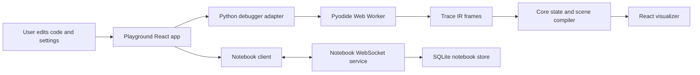

# Collaborative code editor

## Guide

- [Architecture and execution guide](#architecture-and-execution-guide)
- [Run locally](#run-locally)
- [Review code together](#review-code-together)
- [Verification](#verification)
- [Packages](#packages)
- [Current scope](#current-scope)

[Measured notebook protocol results](docs/benchmark-results.md): 141 hosted cells delivered all 29,150 offered edits with zero failures/timeouts. At 32 clients, 48 KiB and 50 aggregate edits/s, scheduled edit-to-all-peer convergence p50 was 8.72 ms (five-repeat range 7.01–9.68) and empirical p99 was 15.52 ms (11.13–17.15). The report includes lower-rate outliers, reconnect/stability, CPU/memory, raw evidence hashes and the reproducible command. These measurements cover the disk-backed Yjs protocol; browser paint and maximum capacity remain unmeasured.

Traceframe is an interactive execution visualizer. It runs Python in a browser worker, records
versioned runtime state, compiles that state through generic projection rules, and synchronizes
the result with editable source code, structured inputs, and timeline controls.

Shared debugging notebooks add code co-editing over WebSockets, server-authenticated online editor/viewer
presence, offline drafts in IndexedDB, SQLite persistence, separate editor/viewer links, and comments
anchored to character identities. Presence lists connected sessions and roles; it does not identify people
and is never written to the document or persistent storage.
Python execution remains local and explicit; receiving shared code never starts a run.


## Run locally

```powershell
npm ci
npm run dev
```

Open `http://127.0.0.1:5173`.

Use Node 24.15 or newer in the 24.x line. The development command builds the packages, starts
the loopback notebook service on port 5190, and proxies it through Vite. Press Ctrl+C to stop
both owned processes. Notebook data is stored in the ignored `.traceframe/notebooks.sqlite`.

## Review code together

1. Open **Shared notebook**, give it a title, and choose **Create notebook from this code**.
2. Copy an editor or viewer link. A link grants its stated access to anyone who possesses it.
3. Editors can change code and run settings. Select code, write a comment, and attach it to the selection.
4. Disconnect the notebook service and keep editing. The local draft survives a normal browser reload;
   reconnecting merges it with the server document. Storage failures appear as errors.
5. Press **Run code** to execute locally, then scrub the trace or save a replay. Remote edits invalidate
   an outdated trace. Projection-only changes keep its frames.

Editor/viewer capabilities are consumed from link fragments and kept in per-tab session storage.
The service stores capability hashes. This is a local capability-based application without accounts
or individual link revocation. Run only code you trust: a browser worker is not a network or resource
security boundary. See [the protocol and limits](docs/notebook-protocol.md) before hosting elsewhere.

The local notebook reuses Traceframe's Yjs browser document and synchronizes source, settings, and comments.
It does not implement the Stanford project's Automerge-based Sublime Text directory synchronization or
filesystem build/grader workflow. See the [original project paper](https://www.scs.stanford.edu/24sp-cs244b/projects/Local-based_collaborative_text_editor_using_CRDT.pdf)
for that distinct system.

The annotation experiment is inspired by [Peritext](https://www.inkandswitch.com/peritext/).
It implements a bounded character-relative comment span policy on Yjs, rather than the full
rich-text algorithm. Its seven named edits compare with fixed integer offsets, then check
disconnected merge convergence and snapshot restoration. The product scope also follows the
complete-application emphasis of [MIT 6.1040](https://61040-fa25.github.io/).

## Verification

```powershell
npm run check
npm test
npm run build
npm run experiment:annotations
npm audit
```

The tests include actual HTTP/WebSocket peers and SQLite restart, as well as deterministic
annotation, storage and client-state checks. The [browser verification skill](.agents/skills/verify-traceframe/SKILL.md)
drives the real Pyodide application, sharing, offline reload, and explicit execution. Unit checks
and rendered browser evidence are recorded separately.

## Packages

```text
Python source
  -> Pyodide worker
  -> serialized trace frames
  -> structural state diff
  -> projection registry
  -> visual scene
  -> interactive React renderer
```

- `@traceframe/core` is the renderer- and language-neutral Trace IR, projection compiler,
  replay format, layouts, and topology motion engine.
- `@traceframe/react` renders scenes, semantic zoom, playback controls, and identity-preserving
  transitions. Import `@traceframe/react/styles.css` once in the host application.
- `@traceframe/python` runs and traces Python in an isolated Pyodide worker.
- `@traceframe/playground` is the proof application under `apps/playground`.

The playground accepts a known example id in the `example` query parameter. Open
`/?example=nested-graphs` for nested graph contracts, or `/?example=nested-bfs` for the same
contract with live breadth-first-search distances and queues. Unknown ids use the default example.

See [docs/architecture.md](docs/architecture.md) for the data model and
[docs/api.md](docs/api.md) for embedding examples.

## Current scope

- Editable Python with fourteen examples
- Script runs and reusable function runs with independently editable JSON arguments
- Top-level function and dotted class-method entrypoints
- Generic tagged object-graph inputs for user-defined classes, sharing, and cycles
- Sandboxed browser execution in a dedicated Web Worker
- Call, line, return, and exception frames
- Complete synchronized call stacks for recursive and nested execution
- Frame-scoped read, call, write, swap, comparison, and branch events
- Evaluated call arguments and results without re-running argument expressions
- Read/call-to-write causal links compiled independently of renderer coordinates
- Caller-visible mutation links for calls that modify containers in place
- Runtime-keyed map focus with readable hash-map access labels
- Single-evaluation augmented-assignment causality for names, attributes, and indexed targets
- Meaningful-frame coalescing and call-scope-aware state diffs
- Lists, structural grids, explicitly contracted adjacency graphs, maps, sets, objects, references,
  scalars, and truncated values
- Deques, ranges, and slot-backed user objects through the same generic projections
- Relation graphs derived from object identity for linked structures and trees
- Topology-aware tree and network layouts for explicitly contracted adjacency sequences and maps
- Source-line highlighting, state diffs, output synchronization, playback, speed, and scrubbing
- A stable execution workspace with compact context views, generic read/change attention, and
  pinning across nested containers
- Token, thumbnail, and full detail levels for nested sequences, grids, mappings, objects, and graphs
- Explicit nested graph views composed alongside their surrounding batches and state
- Direct return-value projection without wrapper assignments or print statements
- Versioned replay files for saving and reopening completed traces
- Bubble sort, grid walk, linked list, binary-tree DFS, and BFS examples

The runtime currently combines source-line tracing with targeted AST instrumentation.

## Architecture and execution guide

Traceframe implements a language-neutral trace model, a Python adapter, projection and replay packages, and a React renderer. The playground and notebook service are applications built on those packages. Pyodide, React, Monaco, Yjs, and SQLite are dependencies rather than Traceframe-owned engines. A [Trace IR](#trace-ir) captures execution facts; a [projection contract](#projection-contract) selects an intentional view.

The worker returns observations, core turns them into scenes, and React presents the trace. Notebook synchronization is separate and never starts execution.



The trace path separates collection from visualization. Core builds [materialized state](#materialized-state) for each trace position and can save a [replay](#replay). Notebook updates travel through a [Yjs document](#yjs-document) between clients and the service; Python execution requires an explicit Run action. Shared access uses a [capability link](#capability-link).

```mermaid
flowchart TD
  subgraph Browser["Browser execution and presentation"]
    Edit["Edit source and run settings"] --> Validate["Validate arguments and contracts"]
    Validate --> Execute["Execute in Pyodide worker"]
    Execute --> Limit{"Error or limit reached?"}
    Limit -->|"No"| Capture["Capture frames and serialize values"]
    Limit -->|"Yes"| Failure["Return visible failure"]
    Capture --> Upgrade["Upgrade and materialize Trace IR"]
    Upgrade --> Project["Apply projections"]
    Project --> Scene["Compile scene and layout"]
    Scene --> Render["Render and scrub frames"]
    Render --> Save["Optionally save replay"]
  end
  subgraph Collaboration["Notebook collaboration"]
    Client["Yjs document client"] <--> Socket["Role-gated WebSocket"]
    Socket <--> Store["SQLite document and capability hashes"]
    Client --> Draft["IndexedDB offline draft"]
  end
```



| Subsystem | Responsibility and owned state | Source |
|---|---|---|
| Trace model and compiler | Trace IR, replay upgrades, execution state, projection registry, scene compilation | [`types.ts`](packages/core/src/types.ts), [`architecture`](docs/architecture.md) |
| Python adapter | Worker lifecycle, request limits, status, and raw-step mapping | [`adapter`](packages/python/src/pyodideDebuggerAdapter.ts), [`worker`](packages/python/src/python.worker.ts) |
| React renderer | Scene rendering, playback, attention workspace, and motion | [`Visualizer.tsx`](packages/react/src/Visualizer.tsx), [`AttentionWorkspace.tsx`](packages/react/src/AttentionWorkspace.tsx) |
| Playground | Source, run settings, trace and replay interaction | [`App.tsx`](apps/playground/src/App.tsx) |
| Notebook client and persistence | Yjs document, IndexedDB draft, connection and merge state | [`useNotebook.ts`](apps/playground/src/notebook/useNotebook.ts), [`persistence.ts`](apps/playground/src/notebook/persistence.ts) |
| Notebook service | Role capabilities, document validation, WebSocket updates and SQLite persistence | [`server.mjs`](apps/notebook-server/src/server.mjs) |

### Execution journey

1. Choose an example or enter Python; select script or function mode and JSON arguments.
2. The adapter sends source to a dedicated worker, which runs Pyodide, instruments execution, and serializes observed values.
3. Core upgrades older traces as needed, materializes state, and applies structural projections. An explicit contract can select an adjacency-list graph.
4. The visualizer renders the scene; playback seeks recorded frames. Replays can be saved and reopened.
5. Time, memory, frame, parse, runtime, or worker failures become visible errors. A source edit invalidates stale results.

### Design decisions and tradeoffs

Rationales are inferred from current implementation.

| Choice | Practical reason | Alternative and cost to reconsider |
|---|---|---|
| Trace IR separates language observations from scenes | Other adapters can feed the same projection and renderer layers | Render Python events directly, coupling language and view code |
| Structural views are defaults; graph views need contracts | A list does not establish graph semantics | Infer graphs heuristically, which can misread ordinary nested lists |
| Python runs in a browser worker | A run does not block UI rendering and can be monitored | Main-thread execution blocks UI; server execution changes code locality |
| Notebook execution is explicit and client-local | Shared edits cannot trigger another participant's code | Auto-run edits, which executes unreviewed shared changes |
| Access uses role links and stored hashes | Grants editor or viewer access without an account system | Add identity and individual revocation, which requires a new lifecycle |

### Glossary

<a id="trace-ir"></a>

<details><summary>What is Trace IR?</summary>

Trace IR is the versioned record of execution events and values. The adapter emits it and core materializes it; it is not the rendered scene.

</details>

<a id="projection-contract"></a>

<details><summary>What is a projection contract?</summary>

A projection contract declares how to view a selected runtime value. An adjacency list can be marked as a directed graph; a missing target selects nothing.

</details>

<a id="materialized-state"></a>

<details><summary>What is materialized state?</summary>

It is reconstructed program state at a trace position, derived from events so frames can be displayed and compared.

</details>

<a id="replay"></a>

<details><summary>What is a replay?</summary>

A replay is a saved versioned trace that can be reopened without rerunning source. Supported older formats pass through the core upgrade path.

</details>

<a id="yjs-document"></a>

<details><summary>What is a Yjs document?</summary>

A Yjs document is a mergeable shared data structure for notebook source, settings, and comments. It synchronizes edits but does not run Python.

</details>

<a id="capability-link"></a>

<details><summary>What is a capability link?</summary>

A capability link grants its role to whoever possesses it. The service stores hashes; there are no individual accounts or per-link revocation.

</details>
